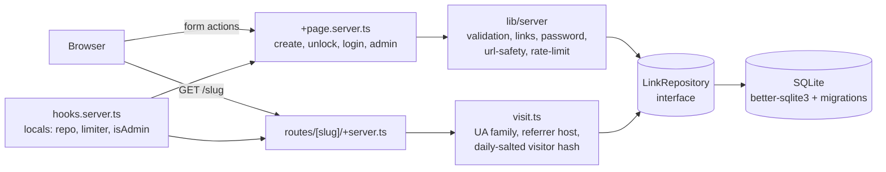

# snaplink

A small, self-hosted URL shortener with privacy-friendly click analytics. One Node process, one
SQLite file, no third-party trackers.

Built with SvelteKit 2, Svelte 5 runes and TypeScript.

## Why

Hosted shorteners are convenient, but they own your links and your visitors' data. snaplink is
meant to be read in an afternoon and run on a single small VM or container. It still covers the
parts that are easy to get wrong: atomic click limits, SSRF-style URL checks, rate limiting and
analytics that never store an IP address.

## Features

- **Short links** with random base62 slugs (collision-safe retries) or custom aliases checked
  against a reserved-word list.
- **Expiry and click limits.** A link stops redirecting at a UTC timestamp or after _N_ clicks.
  The limit is enforced in one atomic SQL statement.
- **Password-protected links.** Passwords are hashed with `scrypt` from `node:crypto`. Unlock
  attempts are rate limited.
- **Redirects** use `302` with `Cache-Control: no-store`, so every visit reaches the server and
  gets counted. `HEAD` requests are answered but not counted.
- **Click analytics** per link: clicks over time as a hand-drawn SVG bar chart, daily unique
  visitors, top referrers, browsers and countries, over 7, 30 or 90 days.
- **QR code** for every link, served as SVG at `/<slug>/qr.svg`.
- **Admin dashboard** behind a single `ADMIN_TOKEN`. Sign-in sets an `httpOnly`,
  `sameSite=lax` session cookie.
- **Progressive enhancement.** Every form is a SvelteKit form action that works without
  JavaScript and is enhanced with `use:enhance` when JavaScript is available. All validation runs
  on the server with zod.
- **Abuse controls.** An in-memory token bucket limits link creation per IP. Only `http`/`https`
  destinations pointing at public hosts are accepted.

## Architecture



| Layer      | Location                             | Responsibility                                                            |
| ---------- | ------------------------------------ | ------------------------------------------------------------------------- |
| Routes     | `src/routes`                         | HTTP only: parse the request, call a service, shape the response          |
| Hook       | `src/hooks.server.ts`                | Injects `locals.repo` and `locals.limiter`, guards `/admin/*`             |
| Services   | `src/lib/server/*.ts`                | Pure or near-pure logic, unit tested without HTTP                         |
| Repository | `src/lib/server/types.ts`            | `LinkRepository` interface: the only storage boundary                     |
| SQLite     | `src/lib/server/db`                  | `better-sqlite3` implementation, prepared statements, migrations          |
| UI         | `src/lib/components`, `+page.svelte` | Svelte 5 runes components; the chart geometry lives in `src/lib/chart.ts` |

Routes read their dependencies from `event.locals`. Tests can therefore call a `load`, an action or
a request handler directly with an in-memory repository and a mocked `RequestEvent`.

### Data model

- `links`: slug (unique), target URL, optional password hash, expiry, max clicks and a click
  counter.
- `clicks`: one row per counted visit with a timestamp, referrer host, country, browser family
  and visitor hash. Rows are deleted with their link (`ON DELETE CASCADE`).
- `daily_salts`: one random 32-byte salt per UTC day. Older salts are deleted.
- `schema_migrations`: the versions the migration runner has applied.

## Privacy

snaplink is designed so that the database holds nothing that identifies a visitor:

- **No raw IP addresses are stored.** A visitor hash is
  `HMAC-SHA256(daily_salt, ip + user_agent)`, truncated. The salt is random, exists for one UTC
  day and is then deleted. After that, a hash cannot be linked to an IP address, even by the
  operator. Hashes from different days cannot be correlated.
- Because of this, "unique visitors" means **daily uniques summed over the range**. A person who
  visits on two different days counts twice. That is the trade-off for not tracking anyone
  across days.
- **Referrers are reduced to a hostname.** Paths and query strings, which often hold search terms
  or tokens, are dropped.
- **User agents are reduced to a browser family** (Chrome, Firefox, Safari, Edge, Bot...). Version
  numbers and OS details are not kept.
- **Country** comes only from an `x-country` header set by a trusted proxy or CDN (for example a
  Cloudflare transform rule that copies `CF-IPCountry`). snaplink does no GeoIP lookup itself. If
  the header is missing, the country is recorded as unknown.

The in-memory rate limiter does see IP addresses. It keeps them only in process memory, for as
long as a bucket is not full.

## Quick start

Requirements: Node.js 22 or newer (24 LTS recommended).

```bash
git clone https://github.com/asmahdy1420-cmyk/snaplink.git
cd snaplink
npm ci
cp .env.example .env        # then set ADMIN_TOKEN
npm run dev                 # http://localhost:5173
```

Production build:

```bash
npm run build
ADMIN_TOKEN=... ORIGIN=https://sl.example.com DATABASE_PATH=./data/snaplink.db npm start
```

With Docker (the database lives in the `/data` volume):

```bash
docker build -t snaplink .
docker run -d -p 3000:3000 \
  -e ADMIN_TOKEN="$(openssl rand -base64 32)" \
  -e ORIGIN=http://localhost:3000 \
  -v snaplink-data:/data \
  snaplink
```

Migrations run automatically on start-up.

## Environment variables

| Variable          | Default              | Description                                                                                                                                    |
| ----------------- | -------------------- | ---------------------------------------------------------------------------------------------------------------------------------------------- |
| `ADMIN_TOKEN`     | _(unset)_            | Secret for signing in at `/admin`. If unset, the admin area is disabled. Use a long random value.                                              |
| `DATABASE_PATH`   | `./data/snaplink.db` | SQLite file path. The directory is created if missing. The Docker image uses `/data/snaplink.db`.                                              |
| `ORIGIN`          | _(unset)_            | Public origin, e.g. `https://sl.example.com`. Required by the Node adapter in production for CSRF checks and for building absolute short URLs. |
| `PUBLIC_CREATION` | `true`               | Set to `false` so that only the signed-in admin can create links.                                                                              |
| `PORT`, `HOST`    | `3000`, `0.0.0.0`    | Listening address (Node adapter).                                                                                                              |
| `ADDRESS_HEADER`  | _(unset)_            | Behind a reverse proxy, set to e.g. `X-Forwarded-For` so rate limiting and visitor hashes use the real client IP.                              |

## Scripts

| Script                 | What it does                                             |
| ---------------------- | -------------------------------------------------------- |
| `npm run dev`          | Vite dev server with hot reload                          |
| `npm run build`        | Production build into `build/` (Node adapter)            |
| `npm start`            | Run the production build                                 |
| `npm run check`        | `svelte-kit sync` and `svelte-check` (strict TypeScript) |
| `npm run lint`         | ESLint (typescript-eslint and eslint-plugin-svelte)      |
| `npm run format`       | Prettier write                                           |
| `npm run format:check` | Prettier check, as run in CI                             |
| `npm test`             | Vitest, single run                                       |
| `npm run test:unit`    | Vitest in watch mode                                     |

## Design decisions

- **The UNIQUE constraint resolves slug collisions, not a lookup.** `createLink` inserts directly.
  On `SQLITE_CONSTRAINT_UNIQUE` it draws a new slug. After half the attempts it adds one
  character. A check-then-insert would race under concurrent requests. With 62^7 (about 3.5
  trillion) possible 7-character slugs, collisions are rare in any case.
- **Click limits are enforced atomically.**
  `UPDATE links SET click_count = click_count + 1 WHERE id = ? AND (max_clicks IS NULL OR click_count < max_clicks) AND (expires_at IS NULL OR expires_at > ?)`
  either takes a click or changes nothing. The click row is inserted in the same transaction. Two
  visitors can never both use the last remaining click.
- **The repository interface is async** even though `better-sqlite3` is synchronous. A
  networked database can replace SQLite without changing routes or services.
- **`better-sqlite3` rather than `node:sqlite`.** It ships prebuilt binaries for Linux, macOS and
  Windows (glibc and musl), so `npm ci` needs no compiler on Node 22/24 or in `node:24-slim`. Its
  synchronous API also makes transactions simple. `node:sqlite` would be a small swap behind the
  same interface.
- **A migration runner of about 40 lines.** Migrations are ordered SQL strings. Each one runs in its
  own transaction and is recorded in `schema_migrations`. Running the runner again does nothing.
- **Stateless admin session.** The cookie holds `HMAC(ADMIN_TOKEN, label)`, never the token
  itself. Rotating the token signs everyone out. There is no session table to clean up.
- **URL safety checks inspect the hostname but do not resolve DNS.** snaplink never fetches the
  destination, so server-side request forgery does not apply. The checks stop the shortener from
  pointing users at loopback, private-network, link-local or `.local` hosts. The WHATWG URL parser
  normalises tricks like `http://2130706433/` and `http://0x7f.1/` before the checks run. A public
  name that resolves to a private IP is not detected; treat that as a known limitation.
- **The chart is plain SVG.** `buildBarChart` is a pure function that returns bar rectangles,
  "nice" integer ticks and thinned labels. A small Svelte component renders it. No charting library is
  shipped to the browser.
- **The rate limiter is in memory.** A token bucket per `action:ip` key fits a single-container
  deployment and resets on restart. Behind several replicas you would move it to Redis or to the
  proxy.

## Running tests

```bash
npm test
```

The Vitest suite covers:

- slug generation and collision retry
- alias validation and URL safety (private IPv4 and IPv6 ranges, alternative notations, schemes)
- expiry and click-limit policy
- scrypt hashing and verification
- user-agent parsing and the token bucket (with an injected clock)
- the SQLite repository against an in-memory database, and migration idempotency and rollback
- chart geometry
- the routes themselves: the redirect handler (`GET`/`HEAD`), the create, unlock, login, delete
  and logout actions, and the admin guard in `hooks.server.ts`. These tests call the handlers
  directly with a mocked `RequestEvent`.

## License

[MIT](LICENSE) © 2026 Ahmed Mahdy
